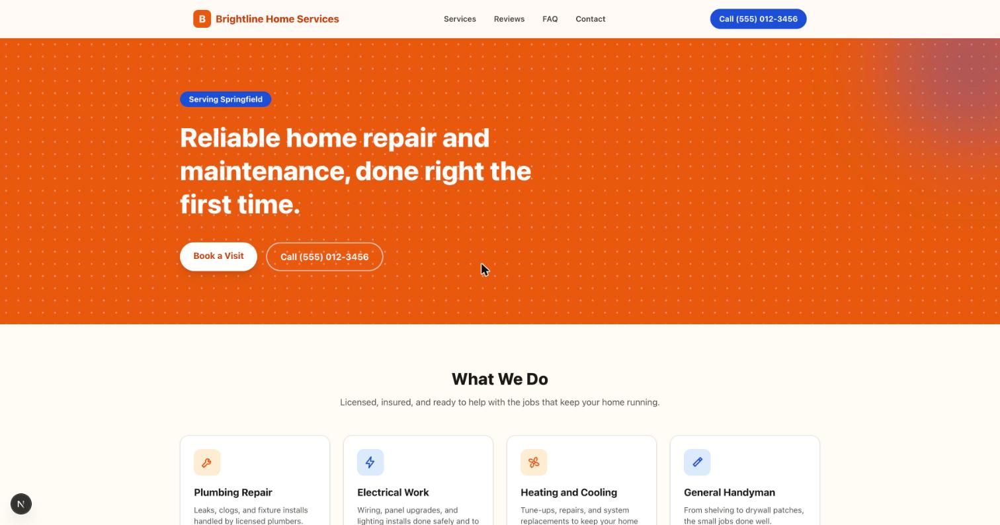

# Local Service Template

White-label website template for local service businesses (contractors, salons, clinics, repair
services). Built with Next.js, TypeScript, and Tailwind CSS.



## Status

Content currently lives in `lib/content.ts`, shaped to match the eventual Sanity schema
(`sanity/schemas`, to be added). Swapping that file for a Sanity fetch is the only change needed
to go live on real client content, no component changes required.

## Structure

- `app/` - routes and the `/api/contact` handler
- `components/` - section components: Nav, Footer, Hero, ServicesGrid, TestimonialCarousel,
  HoursLocation, FAQAccordion, ContactForm
- `lib/theme.ts` - brand tokens (colors, business name) to re-skin for a new client
- `lib/content.ts` - placeholder content, to be replaced by a Sanity data source

## Development

```bash
pnpm install
pnpm dev
```

## Contact form

Posts to `/api/contact`. Sends via Resend when `RESEND_API_KEY` is set in the environment,
otherwise logs the submission to the server console (useful for local development).

## Docker

```bash
docker build -t local-service-template .
docker run -p 3000:3000 local-service-template
```

## Re-skinning for a new client

1. Edit `lib/theme.ts` with the new business name and brand colors.
2. Edit `lib/content.ts` (or point it at a new Sanity dataset) with the client's services,
   testimonials, hours, and contact details.
3. Swap `public/` images and the favicon.
